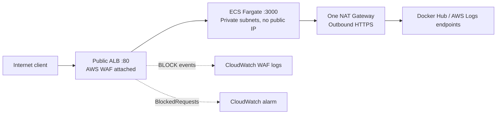

# SecVault-AWS

A practical DevSecOps lab that deploys **OWASP Juice Shop on Amazon ECS Fargate** behind an Application Load Balancer and AWS WAF. Terraform builds the environment, GitHub Actions checks infrastructure and container security, and CloudWatch records blocked requests and detects attack bursts.

The goal is a small, understandable example of **shift-left security** and **defense in depth**. Juice Shop is intentionally vulnerable: use synthetic data and keep deployments short. WAF and private networking do not make the application production-safe.

## Contents

- [How it works](#how-it-works)
- [Project files](#project-files)
- [Requirements and configuration](#requirements-and-configuration)
- [Check the code locally](#check-the-code-locally)
- [Create the backend once](#create-the-backend-once)
- [Deploy the application](#deploy-the-application)
- [Test the application and WAF](#test-the-application-and-waf)
- [Inspect logs and the alarm](#inspect-logs-and-the-alarm)
- [GitHub Actions](#github-actions)
- [Security decisions and limitations](#security-decisions-and-limitations)
- [Free Tier, costs, and cleanup](#free-tier-costs-and-cleanup)
- [Verified AWS demo](#verified-aws-demo)

## How it works



1. The client reaches the public ALB. Its attached WAF Web ACL inspects requests before forwarding them.
2. WAF applies AWS-managed SQLi, Common/XSS, Linux, Unix, and Known Bad Inputs rule groups, plus a small custom command-injection demo rule.
3. Allowed traffic reaches Juice Shop on port 3000. Its security group accepts this port **only from the ALB security group**.
4. One Fargate task runs in one of two private subnets with **no public IP**. There is no EC2 host or SSH access to manage.
5. The task uses outbound TCP 443 through NAT to pull the image and send application logs. The ALB's outbound access is restricted to the task security group on port 3000.
6. WAF sends blocked-request events to CloudWatch. An alarm enters `ALARM` when more than 10 requests are blocked within one 60-second period.

| Component | Why it exists |
| --- | --- |
| VPC and two public subnets | Network boundary and public placement for the ALB; one subnet also hosts NAT |
| Two private subnets | Placement options for Fargate without direct internet addressing |
| Security groups | Restrict which components can communicate and on which ports |
| NAT Gateway and Elastic IP | Outbound IPv4 connectivity for tasks without opening inbound connections |
| ALB and IP target group | Public entry point, request forwarding, and application health checks |
| ECS cluster, task definition, service | Run one 0.5 vCPU / 1 GiB container, maintain its desired count, and deploy new revisions |
| ECS execution role | Image/log operations performed by ECS; Juice Shop receives no application IAM task role |
| WAF Web ACL | Inspect requests and block matching attack patterns |
| CloudWatch log groups | Retain application logs and WAF `BLOCK` events for 7 days |
| CloudWatch alarm | Detect bursts using `AWS/WAFV2 / BlockedRequests`; no notification delivery is configured |
| S3 state backend | Store application Terraform state with encryption, versioning, and native S3 locking |

The ECS deployment circuit breaker detects failed deployments and can roll back when a previous successful deployment exists. One task and one NAT Gateway keep the lab small; they do not provide high availability.

## Project files

```text
SecVault-AWS/
├── .github/
│   ├── workflows/security.yml   # Terraform, tfsec, Bash and Trivy checks
│   └── dependabot.yml          # Weekly GitHub Actions update proposals
├── bootstrap/
│   ├── provider.tf             # Terraform/AWS versions and account restriction
│   ├── main.tf                 # State bucket and its security settings
│   ├── outputs.tf              # State bucket name
│   └── .terraform.lock.hcl     # Locked provider version and checksums
├── terraform/
│   ├── provider.tf             # AWS provider and remote S3 backend
│   ├── network.tf              # VPC, subnets, routes, NAT and security groups
│   ├── compute.tf              # ALB, ECS, execution role and application logs
│   ├── security.tf             # WAF rules and association with the ALB
│   ├── monitoring.tf           # WAF logging and blocked-request alarm
│   ├── outputs.tf              # Application URL, log group and alarm names
│   ├── juice-shop-image.txt    # Image version and immutable SHA-256 digest
│   └── .terraform.lock.hcl     # Locked provider version and checksums
├── scripts/
│   └── chaos_test.sh           # Finite HTTP probes and alarm test burst
├── .gitignore                  # Excludes state, plans, caches and local secrets
└── README.md
```

The application is one Terraform root module with one remote state. `bootstrap/` is a separate module with its own **local state**: the application cannot create the bucket it needs to initialize its backend. There are no modules per AWS service.

## Requirements and configuration

- Terraform **1.10+ and below 2.0**; CI uses **1.15.1**.
- AWS CLI with a valid profile for the intended account.
- tfsec **1.28.14** for local IaC checks.
- Bash and curl for the WAF test; ShellCheck for the same shell lint used in CI.
- Trivy **0.76.1** if running the container scan locally. It can scan the registry image without Docker.
- GitHub Actions enabled; no AWS credentials or repository secrets are required for CI.

All commands below run from the repository root:

```bash
git clone https://github.com/yuspax/SecVault-AWS.git
cd SecVault-AWS
export AWS_PROFILE=default
aws sts get-caller-identity
```

This checkout is configured for:

| Setting | Value / location |
| --- | --- |
| AWS account | `429502077676`, restricted by `allowed_account_ids` in both providers and the application backend |
| AWS Region | `eu-central-1`; subnet availability zones are `eu-central-1a` and `eu-central-1b` |
| State bucket | `secvault-tfstate-429502077676-eu-central-1` |
| Application state key | `juice-shop/terraform.tfstate` |
| Container image | Version and digest in [terraform/juice-shop-image.txt](terraform/juice-shop-image.txt) |
| Task capacity | 0.5 vCPU, 1 GiB RAM, Linux AMD64, desired count 1 |

For another account, change the account restrictions in both `provider.tf` files and update the bucket name in `bootstrap/main.tf` and `terraform/provider.tf`. If changing Region, also update availability zones, log configuration, and alarm dimensions. Bucket names must be globally unique. Never copy AWS access keys into Terraform or GitHub workflows.

## Check the code locally

These static checks do not need AWS credentials or remote state:

```bash
terraform fmt -check -recursive
tfsec bootstrap --minimum-severity HIGH
tfsec terraform --minimum-severity HIGH
terraform -chdir=bootstrap init -backend=false -input=false -lockfile=readonly
terraform -chdir=bootstrap validate
terraform -chdir=terraform init -backend=false -input=false -lockfile=readonly
terraform -chdir=terraform validate
bash -n scripts/chaos_test.sh
shellcheck scripts/*.sh
```

Provider downloads require network access. Commit both `.terraform.lock.hcl` files so local runs and CI select the same provider version. Run `tfsec bootstrap` and `tfsec terraform` without a severity filter to review LOW/MEDIUM findings too.

## Create the backend once

**The configured account already has its backend. Skip this step when using that existing backend.** This section is for a fresh account or for maintaining bootstrap resources with their original local state available.

Bootstrap creates one S3 bucket and five configurations: versioning, SSE-S3 encryption, Block Public Access, ACLs disabled with `BucketOwnerEnforced`, and a bucket policy denying HTTP. The bucket has `prevent_destroy = true` and `force_destroy = false`.

```bash
terraform -chdir=bootstrap init -input=false -lockfile=readonly
terraform -chdir=bootstrap validate
tfsec bootstrap --minimum-severity HIGH
terraform -chdir=bootstrap plan -out=backend.tfplan
```

Review the plan, then create the backend:

```bash
terraform -chdir=bootstrap apply backend.tfplan
terraform -chdir=bootstrap output -raw state_bucket_name
```

Keep a secure backup of `bootstrap/terraform.tfstate`, which is excluded from Git. If the bucket exists but this local state is lost, recover the state or import the bootstrap resources before applying; starting from an empty bootstrap state would attempt to recreate them.

The application uses `use_lockfile = true`, so no DynamoDB table is needed. Its deploying identity needs state access plus `s3:GetObject`, `s3:PutObject`, and `s3:DeleteObject` on `juice-shop/terraform.tfstate.tflock`. See [Terraform's S3 backend permissions](https://developer.hashicorp.com/terraform/language/backend/s3).

## Deploy the application

This architecture consumes billable usage or credits. For the agreed Free-plan demo, check the actual plan, remaining credits, and expiration first:

```bash
aws freetier get-account-plan-state \
  --profile default --region us-east-1 --no-cli-pager
```

Verify `accountPlanType = FREE`, `accountPlanStatus = ACTIVE`, remaining credits, and remaining duration. Do not upgrade the account to complete the demo. See [AWS account plan rules](https://docs.aws.amazon.com/us_en/awsaccountbilling/latest/aboutv2/free-tier-plans.html).

After checks pass, initialize the application backend and generate a fresh plan:

```bash
terraform -chdir=terraform init -reconfigure -input=false -lockfile=readonly
terraform -chdir=terraform plan -out=lab.tfplan
```

Review it before applying. On an empty application state, the current configuration creates 34 resources:

```bash
terraform -chdir=terraform apply lab.tfplan
terraform -chdir=terraform output -raw application_url
```

Terraform waits for ECS service steady state. ALB/NAT provisioning and container startup take several minutes. The output is an **HTTP** URL; HTTPS requires a domain and an ACM certificate and is not configured here.

The AWS deploying identity needs permissions for the resources in the plan. WAF logging additionally needs `wafv2:PutLoggingConfiguration`, `wafv2:DeleteLoggingConfiguration`, `logs:CreateLogDelivery`, `logs:DeleteLogDelivery`, `logs:PutResourcePolicy`, `logs:DescribeResourcePolicies`, and `logs:DescribeLogGroups`. AWS creates the CloudWatch delivery policy when logging is enabled; see [AWS WAF logging permissions](https://docs.aws.amazon.com/waf/latest/developerguide/logging-cw-logs.html).

## Test the application and WAF

First check the normal application response:

```bash
curl --silent --show-error --output /dev/null --write-out '%{http_code}\n' \
  --connect-timeout 5 --max-time 15 \
  "$(terraform -chdir=terraform output -raw application_url)/"
```

Then run the finite test against **your own deployed lab**:

```bash
bash scripts/chaos_test.sh "$(terraform -chdir=terraform output -raw application_url)"
```

The script checks normal traffic, probes SQLi/XSS/traversal/Log4Shell/bad user-agent patterns, and sends 25 requests matching `Custom-Block-CMD` to exercise the alarm. It uses connection/request timeouts, encodes query parameters, preserves traversal paths, and exits instead of looping forever.

Normal traffic should return 200; the custom burst must return 403 for all 25 requests. The script exits nonzero for network failures, an unhealthy normal request, or an unblocked custom-rule request. Managed-rule probes are informational because AWS signatures can change. Confirm 403 responses in WAF logs; HTTP status alone does not establish which component blocked a request.

## Inspect logs and the alarm

Tail blocked-request logs after the test:

```bash
aws logs tail "$(terraform -chdir=terraform output -raw waf_log_group_name)" \
  --region eu-central-1 --since 10m --follow
```

Application startup/runtime logs are separate:

```bash
aws logs tail /ecs/juice-shop --region eu-central-1 --since 10m --follow
```

In CloudWatch Logs Insights, select `aws-waf-logs-juice-shop` and run:

```text
fields @timestamp, httpRequest.clientIp, httpRequest.uri,
       httpRequest.args, action, terminatingRuleId
| filter action = "BLOCK"
| sort @timestamp desc
| limit 50
```

WAF logging keeps only `BLOCK` events. Authorization and Cookie headers are redacted in those logs; WAF sampled requests are separate. Logs contain request metadata and available SQLi/XSS match details, not a complete body dump. Both log groups retain events for 7 days.

The alarm uses `AWS/WAFV2 / BlockedRequests`, `Sum`, a 60-second period, threshold **greater than 10**, and one evaluation period. Its dimensions are `WebACL = juice-shop-waf`, `Rule = ALL`, and `Region = eu-central-1`. Missing data is non-breaching. No SNS/email/Slack action is configured.

Allow a few minutes for metrics/evaluation, then inspect history:

```bash
aws cloudwatch describe-alarm-history \
  --alarm-name "$(terraform -chdir=terraform output -raw waf_alarm_name)" \
  --history-item-type StateUpdate --region eu-central-1
```

History is useful because the alarm may have returned to `OK` after a short burst. See [AWS WAF metric dimensions](https://docs.aws.amazon.com/waf/latest/developerguide/waf-metrics.html) and [log fields](https://docs.aws.amazon.com/waf/latest/developerguide/logging-fields.html).

## GitHub Actions

[security.yml](.github/workflows/security.yml) runs on pull requests, pushes to `master`/`main`, and manual dispatch. It performs CI checks; deployment stays manual and CI does not access the AWS backend.

| Check name | What it checks | Failure behavior |
| --- | --- | --- |
| `Terraform security (bootstrap)` | Formatting, tfsec, backend-free init, validation of the state bucket module | Blocks on invalid code or HIGH/CRITICAL IaC findings |
| `Terraform security (terraform)` | The same checks for the application module | Blocks on invalid code or HIGH/CRITICAL IaC findings |
| `Script checks` | Bash syntax and ShellCheck | Blocks on script syntax/lint errors |
| `Juice Shop CVE report` | Trivy image scan, SARIF artifact, and GitHub Security upload | CVEs are non-blocking; scan/download/artifact/upload errors fail the check |

Trivy uses `exit-code: 0` because Juice Shop is deliberately vulnerable. All severities and unfixed CVEs remain visible in the report. Terraform and Trivy read the **same pinned image** from `terraform/juice-shop-image.txt`; both target Linux AMD64.

Find the SARIF artifact under **Actions → Security checks → run → Artifacts → juice-shop-trivy-sarif**; retention is 7 days. Results are uploaded to **Security → Code scanning** in this public repository. Fork PRs skip that upload because their token is restricted, while keeping the artifact. A private fork may require GitHub Code Security; see [GitHub SARIF requirements](https://docs.github.com/en/code-security/how-tos/find-and-fix-code-vulnerabilities/integrate-with-existing-tools/upload-sarif-file).

Actions are pinned to commit SHAs. Dependabot proposes weekly Action updates; Terraform/tfsec/Trivy binary versions are explicit and should be reviewed when upgrading. Token permissions default to read; only the report job requests `security-events: write`. Checkout does not persist Git credentials. The workflow does not run attack traffic against AWS.

For merge enforcement, the four check names above are the required status-check contexts on `master`. Repository administrators retain the standard bypass; ordinary changes should go through a pull request and passing checks. The first real Actions execution and Security UI verification require the workflow to be pushed; local validation does not substitute for that hosted run.

After publication, inspect the automatic run or trigger a fresh one:

```bash
gh workflow run security.yml --ref master
gh run list --workflow security.yml --limit 5
```

## Security decisions and limitations

There are five documented, resource-scoped tfsec exceptions:

| Exception | Reason |
| --- | --- |
| Public ALB | Intended WAF-protected internet entry point |
| Public ingress on ALB port 80 | Domain-free HTTP demo |
| HTTP listener | No domain/ACM certificate; there is currently no TLS termination |
| Task egress on port 443 to public addresses | Docker Hub and CloudWatch endpoints use public addresses; this limits ports, not destinations |
| State bucket without a customer-managed KMS key | Uses SSE-S3 encryption; the check for entirely missing bucket encryption remains blocking |

Port exceptions are attached to standalone security group rules so changing port 80/443 to SSH is not silently ignored. Negative checks confirmed that public SSH and removed S3 encryption fail the IaC gate.

Accepted LOW/MEDIUM findings include no VPC flow logs, no Container Insights, AWS-managed log encryption rather than a customer-managed key, and no S3 access-log bucket. Run unfiltered tfsec to inspect them. tfsec is [now part of Trivy](https://github.com/aquasecurity/tfsec); TFLint would complement this setup but would not replace security scanning.

Private subnets block direct public addressing, not every consequence of an application compromise. Outbound HTTPS is not an exfiltration-proof allowlist. WAF rules, including the simple custom byte-match example, do not cover all attacks. One task and a single-zone NAT are deliberate lab tradeoffs. Production follow-up work would include HTTPS, appropriate availability, tuned rules, and notification delivery.

## Free Tier, costs, and cleanup

**This is not an always-free architecture.** NAT Gateway, public IPv4 addresses, ALB, Fargate, WAF, and logs consume billable usage. Eligible Free-plan usage consumes credits; a Paid plan can bill beyond credits. Replacing Fargate with EC2 alone would not remove the other costs.

Use a short **deploy → test → destroy** session. There is no scheduled automatic cleanup in this repository. Check AWS and finish cleanup if your session is interrupted. A single NAT keeps the lab smaller but creates an availability dependency and may incur cross-zone transfer charges.

Generate a fresh cleanup plan and review it:

```bash
terraform -chdir=terraform plan -destroy -out=cleanup.tfplan
terraform -chdir=terraform apply cleanup.tfplan
terraform -chdir=terraform state list
```

Successful cleanup removes 34 application resources; `state list` should print nothing. Wait for Terraform to finish: ECS can remain in `DRAINING` during deletion, and zero running tasks alone does not prove the ALB or NAT is gone. See the [AWS deletion lifecycle](https://docs.aws.amazon.com/AmazonECS/latest/APIReference/API_DeleteService.html). Confirm that no lab ALB, active NAT Gateway, or lab Elastic IP allocation remains in AWS.

Application cleanup deletes both log groups and the alarm. The S3 backend belongs to the separate bootstrap state and is **retained**, including earlier state versions. Do not run bootstrap destruction as routine cleanup; it is guarded by `prevent_destroy`. Its retained storage and requests still consume usage. Keep state/plan files out of Git and keep the bootstrap local state backed up securely.

## Verified AWS demo

On **25 October 2026**, this configuration was deployed and tested in `eu-central-1` on an active AWS Free plan using credits. It created 34 resources; Fargate reached steady state, and its actual task ENI had no public IPv4.

| Probe | Observed response |
| --- | --- |
| Normal visit | 200 |
| SQLi | 403 |
| XSS | 403 |
| LFI/traversal | 400 — not counted as a WAF block |
| Log4Shell header | 403 |
| Bad user-agent | 403 |
| Custom command-injection burst | 25/25 returned 403 |

CloudWatch confirmed **29 WAF BLOCK events**: 25 custom-rule matches, 1 SQLi rule-group match, 2 Common rule-group matches, and 1 Known Bad Inputs match. `BlockedRequests` recorded `Sum = 29` for the minute beginning **13:36 Europe/Warsaw**. Alarm history confirmed **OK → ALARM at 13:37:16**.

All **34 application resources were then destroyed**. Read-only verification completed at **13:49:58 Europe/Warsaw**: application state empty, ALB/VPC/WAF/alarm/log groups/execution role absent, NAT deleted, Elastic IP released, and ECS inactive with no running tasks. The six bootstrap resources were retained. The account remained `FREE / ACTIVE`; final credit accounting can arrive later, so no exact-cost or zero-credit-consumption claim is made.

The application is currently undeployed. This demo verifies the AWS path; the first hosted GitHub Actions run and SARIF publication remain pending until push.
